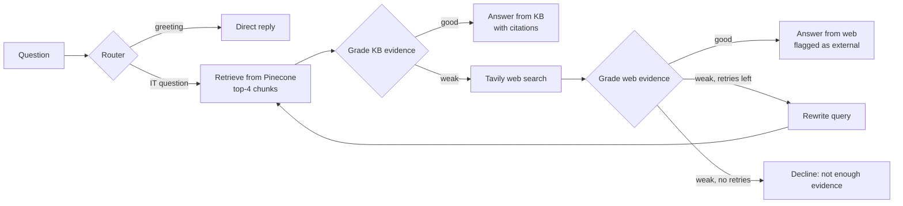

# Enterprise IT Support Copilot (Agentic RAG)

[](https://github.com/tarubee19/Enterprise-IT-Support-Agentic-RAG-Copilot/actions/workflows/ci.yml)


An internal help-desk assistant that answers IT questions (VPN, MFA, password resets, laptop setup)
from a company's own documents, and only goes to the web when those documents are not enough.
Every answer comes with its sources and the path the agent took to reach it.

The interesting part is not the chat box. It is the decision logic around retrieval:

* **Private knowledge first.** Questions are answered from the internal knowledge base when the
  retrieved evidence is good enough.
* **Evidence is graded, not assumed.** An LLM grader checks whether the retrieved chunks actually
  answer the question before anything is generated.
* **Web search is a fallback, and it is labelled.** If internal evidence is weak, the agent searches
  the web (Tavily), grades that too, and marks the answer as external information.
* **It can say "I don't know".** After a bounded number of query rewrites, it declines instead of
  inventing an answer.

## How it works



The graph has 10 nodes and is built with LangGraph (`app/rag/workflow.py`). Routing and grading use
structured JSON outputs, so each decision is a typed value rather than free text. Every step appends
to a trace that the UI shows next to the answer and that is stored in an SQLite audit log.

**Ingestion.** PDF, DOCX, TXT and Markdown files are split with a recursive splitter
(900 characters, 120 overlap), embedded with `text-embedding-3-small` and stored in a Pinecone
serverless index. New documents can be added from the UI through an admin-protected upload endpoint.

## Run it

You need API keys for OpenAI, Pinecone and Tavily.

```bash
git clone https://github.com/tarubee19/Enterprise-IT-Support-Agentic-RAG-Copilot.git
cd Enterprise-IT-Support-Agentic-RAG-Copilot
python -m venv .venv && source .venv/bin/activate
pip install -r requirements.txt

cp .env.example .env              # add your keys and set ADMIN_API_KEY
python ingest_sample_kb.py        # index the sample IT handbook and runbook
python run.py                     # http://127.0.0.1:8080
```

With Docker:

```bash
docker build -t it-copilot .
docker run --env-file .env -p 8080:8080 it-copilot
```

## API

| Method | Path | Purpose |
|---|---|---|
| `POST` | `/api/chat` | `{"question": "..."}` → answer, source used, citations, agent trace, rewritten query |
| `POST` | `/api/ingest` | Upload a document (header `x-admin-key`), returns the number of chunks indexed |
| `GET` | `/api/health` | Liveness check |

Interactive docs are at `/docs` when the server is running.

## Safety and robustness

* Uploads are disabled until a non-default `ADMIN_API_KEY` is set; the key is compared in constant
  time, file types are allow-listed and files are capped at 10 MB.
* Internal errors are logged on the server and never returned to the client.
* The Pinecone index is never deleted automatically. If the embedding size does not match an
  existing index, the app stops with a clear message.
* Answers are rendered without HTML injection in the UI, and request bodies are validated with Pydantic.

## Tests

```bash
pip install pytest httpx
pytest -q
```

The tests run without API keys or network access. They cover document loading and chunking, every
routing decision in the graph (including the retry limit and the decline path), and the API guards.
CI runs them on every push.

## Project layout

```
app/
  rag/workflow.py       LangGraph agent: route, retrieve, grade, web search, rewrite, answer
  rag/vectorstore.py    OpenAI embeddings + Pinecone index and retriever
  rag/state.py          typed agent state and structured-output schemas
  services/ingestion.py loaders for PDF / DOCX / TXT / MD and chunking
  services/audit.py     SQLite audit log of questions, routes and traces
  api/routes.py         FastAPI endpoints
templates/, static/     chat UI with the agent-trace panel
data/sample_kb/         sample IT handbook and service-desk runbook (fictional company)
notebooks/              the original notebook prototype of the agent
tests/                  pytest suite (runs in CI)
```

## Limitations and next steps

* There is no labelled evaluation set yet. The next step is a set of questions with expected
  sources, to measure retrieval hit rate, answer faithfulness, correct refusals and latency.
* Retrieval is dense-only. Hybrid search (BM25 + embeddings) and a reranker are natural additions.
* The sample knowledge base describes a fictional company.

## License

Apache-2.0
